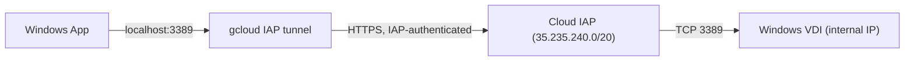
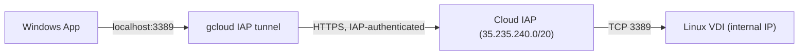

# Enterprise Compute Engine VDI

Provisions dedicated, private Compute Engine Virtual Machines (VDIs) for users specified in `linux_vdi_users` and `windows_vdi_users`.

### Overview
- **Pre-Existing Network**: Uses a provided VPC network (`network_name`) and subnetwork (`subnetwork_name`). This blueprint does not create new VPCs or subnets.
- **Zero Public IPs**: All VMs have internal RFC 1918 IPs only (no external public IPs).
- **Mandatory IAP**: Inbound access is strictly routed through Google Cloud Identity-Aware Proxy (IAP). Direct internet access is blocked.
- **1:1 Isolation**: Users can only tunnel to and authenticate against their assigned VM.
- **No User Admin Access (Linux)**: Linux users get `roles/compute.osLogin` (no `sudo`). Software is installed by administrators via Terraform (see [Admin-Managed Software](#admin-managed-software-linux)). Break-glass sudo is granted only to `vdi_admin_members`.
- **Naming Rule**:
  - Linux: `<username>-<domain>-vdi`
  - Windows: `<username>-<domain>-win-vdi`

---

## How to Connect

All connections require **Cloud IAP**. Make sure you have `gcloud` installed and authenticated (`gcloud auth login`).

### 1. Linux VDI: Terminal SSH (via IAP)

```bash
gcloud compute ssh <instance-name> \
  --zone=us-central1-a \
  --tunnel-through-iap \
  --project=YOUR_PROJECT_ID
```

*Example:*
```bash
gcloud compute ssh alice-example-com-vdi \
  --zone=us-central1-a \
  --tunnel-through-iap \
  --project=my-vdi-project
```

#### Port Forwarding (e.g. Localhost Web App / Notebook)
```bash
gcloud compute ssh <instance-name> \
  --zone=us-central1-a \
  --tunnel-through-iap \
  --project=YOUR_PROJECT_ID \
  -- -L 8080:localhost:8080
```

---

### 2. Linux VDI: VS Code Remote-SSH

Add the following to `~/.ssh/config` on your local machine:

```text
Host vdi-linux
  HostName <instance-name>
  ProxyCommand gcloud compute start-iap-tunnel %h %p --listen-on-stdin --project=YOUR_PROJECT_ID --zone=us-central1-a
  StrictHostKeyChecking no
  UserKnownHostsFile /dev/null
```

In VS Code: Press `Cmd+Shift+P` > **Remote-SSH: Connect to Host...** > select `vdi-linux`.

---

### 3. Linux VDI: Remote Desktop (RDP via IAP)

Connecting to Linux via RDP is supported using XRDP and Windows App. This provides a traditional desktop experience similar to Windows.

See [Appendix B](#appendix-b-connect-to-a-linux-vdi-with-iap-and-windows-app-rdp) for detailed instructions.

---

### 4. Windows VDI: Remote Desktop (RDP via IAP)

Connecting to Windows requires forwarding RDP (port 3389) through an IAP tunnel and connecting
with an RDP client such as [Windows App](https://learn.microsoft.com/windows-app/overview).

> [!TIP]
> Your instance name is `<username>-<domain>-win-vdi` (e.g. `jane@example.com` becomes
> `jane-example-com-win-vdi`). Ready-to-use commands are also in `terraform output windows_vdi_instances`.
1. **Generate Windows Password** (first time only; re-running it **resets** the password):
   ```bash
   gcloud compute reset-windows-password <windows-instance-name> \
     --zone=us-central1-a \
     --project=YOUR_PROJECT_ID
   ```
   Save the returned `username` and `password`.
2. **Start Local IAP TCP Tunnel**:
   ```bash
   gcloud compute start-iap-tunnel <windows-instance-name> 3389 \
     --local-host-port=localhost:3389 \
     --zone=us-central1-a \
     --project=YOUR_PROJECT_ID
   ```
   Wait for `Listening on port [3389].` and *keep this terminal open while using RDP*.
3. **Connect with Windows App**:
   - Click **+** > **Add PC**.
   - **PC name**: `localhost:3389`
   - **Credentials**: username and password from Step 1 (if rejected, use `.\<username>`).
   - Save, double-click the PC, and accept the self-signed certificate warning.

For later sessions, repeat only Steps 2 and 3.

*Example:*
```bash
gcloud compute reset-windows-password jane-example-com-win-vdi \
  --zone=us-central1-a \
  --project=my-vdi-project

gcloud compute start-iap-tunnel jane-example-com-win-vdi 3389 \
  --local-host-port=localhost:3389 \
  --zone=us-central1-a \
  --project=my-vdi-project
```

See [Appendix A](#appendix-a-connect-to-a-windows-vdi-with-iap-and-windows-app) for installation, detailed Windows App settings, and troubleshooting.

---

## Admin-Managed Software (Linux)

VDI users cannot install software. Administrators define software bundles in
`terraform.tfvars`, and the [OS Config](https://cloud.google.com/compute/docs/os-configuration-management)
agent on each VDI installs them (as root) and keeps them installed.

```hcl
linux_vdi_software = {
  dev-tools = {
    packages = ["git", "jq", "unzip"]              # all Linux VDIs
  }
  vscode = {
    apt_repository = {
      uri          = "https://packages.microsoft.com/repos/code"
      distribution = "stable"
      gpg_key      = "https://packages.microsoft.com/keys/microsoft.asc"
    }
    packages = ["code"]
  }
  data-team = {
    packages = ["postgresql-client"]
    users    = ["alice@example.com"]               # only this user's VDI
  }
}

# Removing a package from a bundle does NOT uninstall it; list it here instead:
linux_vdi_removed_packages = ["telnet"]
```

Workflow: open a PR that edits the tfvars, then the pipeline applies it and VDIs converge within minutes.
Per-VM status is in **Compute Engine > VM Manager > OS policies**.

---

## Official Documentation

- [Google Cloud Documentation: Connect to Windows Instances using RDP over IAP](https://cloud.google.com/compute/docs/instances/connecting-to-instance#rdp-iap)
- [Google Cloud Documentation: Using IAP for TCP Forwarding](https://cloud.google.com/iap/docs/using-tcp-forwarding)
- [Google Cloud Documentation: OS Login Overview](https://cloud.google.com/compute/docs/oslogin)
- [Microsoft Learn: Windows App Overview](https://learn.microsoft.com/windows-app/overview)

---

## Appendix A: Connect to a Windows VDI with IAP and Windows App

[Windows App](https://learn.microsoft.com/windows-app/overview) is Microsoft's current Remote Desktop client. It replaces
"Microsoft Remote Desktop". The VDI has no public IP, so Windows App connects to a **local IAP tunnel**, and
`gcloud` forwards that traffic to port 3389 on the VM.



### Prerequisites

- Your identity is listed in `windows_vdi_users` and Terraform has been applied.
- The [Google Cloud CLI](https://cloud.google.com/sdk/docs/install) is installed and authenticated:
  ```bash
  gcloud auth login
  ```
- Windows App is installed:
  - **macOS**: [Mac App Store](https://apps.apple.com/app/windows-app/id1295203466)
  - **Windows**: Microsoft Store (search for "Windows App")
- You know your instance name (`<username>-<domain>-win-vdi`). An administrator can list
  instances and ready-to-use commands with:
  ```bash
  terraform output windows_vdi_instances
  ```

### Step 1: Generate Windows credentials (first time only)

```bash
gcloud compute reset-windows-password <windows-instance-name> \
  --zone=us-central1-a \
  --project=YOUR_PROJECT_ID
```

Save the returned `username` and `password` in a password manager.

> [!NOTE]
> Running this command again **resets** the password for that user. Add `--user=<name>` to choose a
> specific local username instead of your local OS username.

### Step 2: Start the IAP tunnel

```bash
gcloud compute start-iap-tunnel <windows-instance-name> 3389 \
  --local-host-port=localhost:3389 \
  --zone=us-central1-a \
  --project=YOUR_PROJECT_ID
```

Wait for `Listening on port [3389].` and **keep this terminal open** for the whole session. Press
`Ctrl+C` to close the tunnel when you are done.

> [!TIP]
> If local port 3389 is already in use (common on Windows laptops with Remote Desktop enabled), use
> another port, e.g. `--local-host-port=localhost:13389`, and use `localhost:13389` in Step 3.

### Step 3: Add the PC in Windows App

1. Open **Windows App** and go to the **Devices** tab.
2. Click **+** > **Add PC**.
3. Fill in the form:

   | Field | Value |
   | --- | --- |
   | **PC name** | `localhost:3389` (or the custom port from Step 2) |
   | **Credentials** | **Add credentials...** > username and password from Step 1 |
   | **Friendly name** | e.g. `GCP Windows VDI` |
   | **Gateway** | *No gateway* |

4. Click **Add**.

> [!TIP]
> If the username is rejected, prefix it with `.\` (e.g. `.\jane`) to indicate a local account.

### Step 4: Connect

1. Make sure the tunnel from Step 2 is running.
2. Double-click the saved PC in Windows App.
3. On the first connection, a certificate warning appears because the VM uses a self-signed RDP
   certificate. Check that the certificate name matches your VM, then click **Continue**. On macOS, select
   **Show Certificate** > **Always trust** to skip the prompt next time.

For later sessions, repeat only **Step 2** and **Step 4**.

### Troubleshooting

| Symptom | Likely cause / fix |
| --- | --- |
| Windows App: *"We couldn't connect to the remote PC"* (e.g. `0x204`) | The IAP tunnel is not running or uses a different port. Restart Step 2 and check the PC name. |
| `gcloud`: *"Could not bind to localhost:3389"* | Local port in use. Pick another port (see the tip in Step 2). |
| `gcloud`: error `4033` / *"not authorized"* | Missing `roles/iap.tunnelResourceAccessor`. Confirm you are in `windows_vdi_users` and Terraform was applied. |
| `gcloud`: error `4003` / *"failed to connect to backend"* | Firewall does not allow `35.235.240.0/20` on TCP 3389, or the VM is stopped / still booting. |
| `gcloud`: error `4047` / *"failed to lookup instance"* | Wrong instance name, zone, or project. |
| Login fails with valid-looking credentials | The password was reset by another run of Step 1, or the username needs the `.\` prefix. |
| Slow or laggy session | Install NumPy for the `gcloud` Python runtime to speed up IAP tunneling (see the [IAP TCP forwarding docs](https://cloud.google.com/iap/docs/using-tcp-forwarding#increasing_the_tcp_upload_bandwidth)). |

---

## Appendix B: Connect to a Linux VDI with IAP and Windows App (RDP)

[Windows App](https://learn.microsoft.com/windows-app/overview) can also be used to connect to Linux VDIs via XRDP. The VDI has no public IP, so Windows App connects to a **local IAP tunnel**, and `gcloud` forwards that traffic to port 3389 on the VM.



### Prerequisites

- Your identity is listed in `linux_vdi_users` and Terraform has been applied.
- The [Google Cloud CLI](https://cloud.google.com/sdk/docs/install) is installed and authenticated:
  ```bash
  gcloud auth login
  ```
- Windows App is installed (see [Appendix A](#appendix-a-connect-to-a-windows-vdi-with-iap-and-windows-app) for links).
- You know your instance name (`<username>-<domain>-vdi`).

### Step 1: Identify your automated username

Your username is automatically derived from your email address by converting all non-alphanumeric characters to underscores (e.g., `alice@example.com` becomes `alice_example_com`).

### Step 2: Start the IAP tunnel

**Option A: Using `start-iap-tunnel`**

```bash
gcloud compute start-iap-tunnel <linux-instance-name> 3389 \
  --local-host-port=localhost:3389 \
  --zone=us-central1-a \
  --project=YOUR_PROJECT_ID
```

**Option B: Using `ssh` with Port Forwarding**

```bash
gcloud compute ssh <linux-instance-name> \
  --zone=us-central1-a \
  --project=YOUR_PROJECT_ID \
  --tunnel-through-iap \
  -- -L 3389:localhost:3389 -N
```

Wait for the tunnel to establish and **keep this terminal open** for the whole session. Press `Ctrl+C` to close the tunnel when you are done.

> [!TIP]
> If local port 3389 is already in use (e.g., you are also connected to a Windows VDI), use another port, e.g. `--local-host-port=localhost:13389`, and use `localhost:13389` in Step 3.

### Step 3: Add the PC in Windows App

1. Open **Windows App** and go to the **Devices** tab.
2. Click **+** > **Add PC**.
3. Fill in the form:

   | Field | Value |
   | --- | --- |
   | **PC name** | `localhost:3389` (or the custom port from Step 2) |
   | **Credentials** | **Add credentials...** > Username: your automated username (Step 1); Password: **Leave Empty** |
   | **Friendly name** | e.g. `GCP Linux VDI` |
   | **Gateway** | *No gateway* |

4. Click **Add**.

### Step 4: Connect

1. Make sure the tunnel from Step 2 is running.
2. Double-click the saved PC in Windows App.
3. Accept any certificate warnings.

For later sessions, repeat only **Step 2** and **Step 4**.
